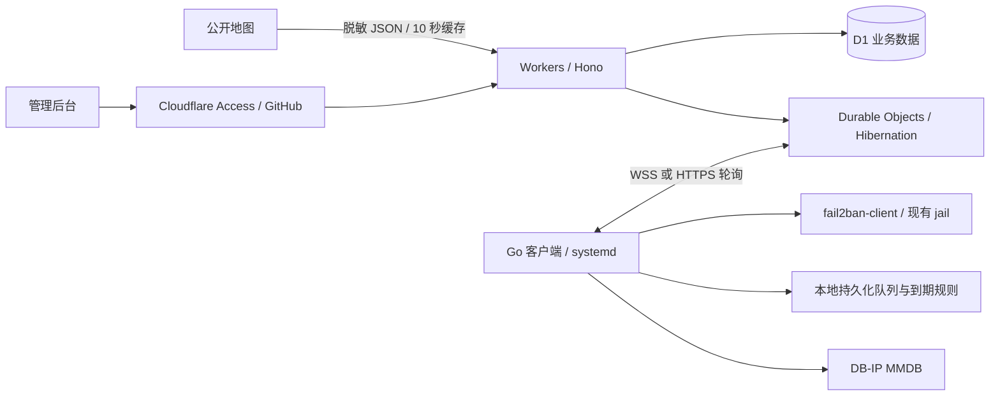

# Fail2ban Mate

部署在 **Cloudflare Workers + D1** 上的 fail2ban 远程控制台。Go 客户端主动连接控制端，Linux 节点无需开放管理端口。适合个人管理 1–20 个节点。

## 功能

- 中文管理后台、公开世界地图与动态来源连线，支持手机访问。
- 每节点独立 token，Cloudflare Access + GitHub 登录管理后台。
- WebSocket 实时同步，HTTP 轮询备用；连续失败、频繁断线时自动降级，稳定后自动恢复。
- 手动封禁、单次解封、批量解封，以及覆盖所有节点和 service 的限时放行、永久白名单。
- 限时放行在客户端本地到期，控制端断网仍可恢复正常检测；保留节点原有白名单。
- DB-IP City Lite 本地查询来源城市，无定位 API 密钥；按月更新。
- 一行安装命令、systemd、自带升级和卸载流程；GitHub Actions 发布客户端双架构二进制；Cloudflare Workers Builds 负责服务端构建与部署。

公开页面仅返回脱敏 IP：来源 IPv4 `1.2.3.x`、节点 IPv4 `1.2.x.x`；IPv6 来源保留前三组，节点保留前两组。完整 IP 仅在后台可见。地图数据随网页分发，无地图 API 或第三方瓦片请求。

## 当前部署

- 公开看板：[fail2ban-mate.cloverstd.workers.dev](https://fail2ban-mate.cloverstd.workers.dev)
- 管理后台：[进入后台](https://fail2ban-mate.cloverstd.workers.dev/admin)，通过 Cloudflare Access 的 GitHub 身份提供商登录，仅允许 `cloverstd@gmail.com`。
- 服务端 CI：Cloudflare Workers Builds 连接本仓库 `main`，负责检查、构建、D1 迁移和部署；非生产分支构建已关闭。
- Access 使用现有团队 `cloverstd.cloudflareaccess.com`，仅保护后台页面和管理 API，公开页面与 agent 接口保持公开路由。
- 客户端版本与二进制：[GitHub Releases](https://github.com/cloverstd/fail2ban-mate/releases)。

## 架构



D1 是云端业务数据的持久化存储；Durable Objects 负责逐节点串行处理、连接和后台通知。客户端使用原子写入、`fsync` 和进程文件锁保护本地队列、命令去重记录及白名单归属。

## 首次部署

需要 Node.js 22.12+、pnpm 9、Go 1.26，以及可使用 Workers、D1、Durable Objects 和 Zero Trust Access 的 Cloudflare 账号。

### 1. 创建 D1

```sh
git clone https://github.com/cloverstd/fail2ban-mate.git
cd fail2ban-mate
corepack enable
pnpm install --frozen-lockfile
pnpm exec wrangler login
pnpm exec wrangler d1 create fail2ban-mate
```

本项目的 D1 已创建，生产数据库 ID 为 `938674ac-567c-4583-a6b4-64ba0b78633a`，已写入 `wrangler.jsonc`。在其他账号部署时，用新建数据库 ID 覆盖构建变量 `D1_DATABASE_ID`。

### 2. 配置 GitHub 和 Cloudflare Access

1. 在 Cloudflare 账号中启用 Zero Trust，确认团队域名，例如 `https://your-team.cloudflareaccess.com`。
2. 在 GitHub Settings → Developer settings → OAuth Apps 创建 OAuth App。
3. Homepage URL 填团队域名；Authorization callback URL 填 `https://your-team.cloudflareaccess.com/cdn-cgi/access/callback`。
4. 在 Cloudflare Zero Trust → Integrations → Identity providers 添加 GitHub，将 GitHub Client ID / Secret 配置到 Cloudflare。OAuth secret 不进入 Worker、GitHub 仓库或网页。
5. 为 Worker 域名创建一个 **Self-hosted Access Application**。可先确定默认域名 `fail2ban-mate.<你的子域>.workers.dev`，也可使用自定义域名。
6. 在同一个 Application 添加以下路径，确保它们共用一个 AUD：`/admin`、`/admin/*`、`/api/admin/*`。按控制台路径规则覆盖 `/admin` 及其子路径，并验证 API 路径同样受保护。
7. Allow 策略仅允许管理员邮箱，并限定 GitHub 身份提供商。Worker 的 `ADMIN_EMAILS` 必须包含相同的邮箱，用英文逗号分隔。
8. 保存 Application Audience (AUD)。公开首页、`/api/public/*`、`/api/agent/v1/*`、`/install.sh` 不应进入 Access 登录保护，否则客户端会收到登录 HTML。

Worker 本身也会校验 JWT，因此通过备用域名绕过 Access 边缘策略时，后台仍拒绝无效身份。缺失认证配置会直接拒绝访问；项目不提供生产认证绕过开关。

参考：[Access GitHub 身份提供商](https://developers.cloudflare.com/cloudflare-one/integrations/identity-providers/github/)、[Access JWT 校验](https://developers.cloudflare.com/cloudflare-one/access-controls/applications/http-apps/authorization-cookie/validating-json/)。

### 3. 配置 Cloudflare Workers Builds

服务端由 **Cloudflare Workers Builds** 从 GitHub 拉取源码后构建和部署。GitHub Actions 负责代码检查与 Go 客户端发布，不部署 Worker，也不需要在 GitHub 保存 Cloudflare 部署凭据。

在 Cloudflare → Workers & Pages → `fail2ban-mate` → Settings → Builds，连接 GitHub 仓库 `cloverstd/fail2ban-mate`。使用以下配置：

| 配置                                    | 值                                                                   |
| --------------------------------------- | -------------------------------------------------------------------- |
| Production branch                       | `main`                                                               |
| Root directory                          | `/`                                                                  |
| Build command                           | `pnpm run build:cloudflare`                                          |
| Deploy command                          | `pnpm run deploy:cloudflare`                                         |
| Non-production branch builds / Previews | 关闭，避免其他分支使用生产 D1                                        |
| Build token                             | Cloudflare 管理的部署 token，需有 Workers Scripts 编辑和 D1 编辑权限 |

Build command 生成部署配置，运行 TypeScript / Vite 构建、Workers 集成测试和部署配置测试。Deploy command 在迁移成功后才部署 Worker；迁移失败会停止部署。若 Access 配置未完成，构建会明确报错，保留当前部署。

在 **Cloudflare Builds 构建变量** 中配置：

| 名称                 | 值                                               |
| -------------------- | ------------------------------------------------ |
| `NODE_VERSION`       | `22`                                             |
| `ACCESS_TEAM_DOMAIN` | `https://your-team.cloudflareaccess.com`         |
| `ACCESS_AUD`         | Access Application 的 AUD                        |
| `ADMIN_EMAILS`       | 已默认设为 `cloverstd@gmail.com`，可选覆盖       |
| `D1_DATABASE_ID`     | 已默认设为本项目生产 D1 ID，其他账号部署时覆盖   |
| `WORKER_DOMAIN`      | 可选，例如 `ban.example.com`，不要包含协议或路径 |

`packageManager` 将 pnpm 固定为 `9.15.9`。Access 的团队域名、AUD 和邮箱属于非敏感运行配置，部署脚本会写入 Worker vars；GitHub OAuth secret 只保存在 Cloudflare Access 身份提供商中。

Workers Builds 的 GitHub App 首次安装需要 GitHub 账号所有者授权。使用 API 管理 Builds 时，需要具有 **Workers Builds Configuration: Edit** 的用户级 API token；Wrangler 默认 OAuth 的部署权限不包含这项配置权限。配置 Zero Trust 组织、身份提供商与应用，还分别需要 Access 组织/身份提供商编辑、Access 应用/策略编辑权限。

参考：[Workers Builds 配置 API](https://developers.cloudflare.com/workers/ci-cd/builds/api-reference/)。API 读取到的真实资源 ID 才能用于配置，不能用猜测的团队域名或 AUD 代替。

迁移应只使用兼容旧 Worker 的增量修改；代码回滚不会自动回滚 D1。迁移文件提交前应先在本地和测试环境执行。

### 手动部署

将上表中的 Access 构建变量设置为当前命令环境变量，再执行：

```sh
node scripts/configure-deploy.mjs
pnpm build
pnpm exec wrangler d1 migrations apply DB --remote --config wrangler.deploy.json
pnpm exec wrangler deploy --config wrangler.deploy.json
```

`wrangler.deploy.json` 为忽略的本地生成文件，`wrangler.jsonc` 保持可复用模板。Wrangler 可使用本地登录会话，或 `CLOUDFLARE_API_TOKEN` / `CLOUDFLARE_ACCOUNT_ID`。

管理员默认邮箱为 `cloverstd@gmail.com`。Access 配置为空时，Worker 保持拒绝后台访问。

## 添加 Linux 节点

1. 登录 `/admin`，打开「节点管理」→「添加节点」。
2. 复制生成的一行 `curl` 命令到目标 Linux 主机执行。
3. 安装器自动识别 amd64 / arm64，校验 GitHub Release 的 SHA-256；缺少 fail2ban 时通过 apt、dnf 或 yum 安装。RHEL 系必要时尝试 EPEL，仓库不可用则给出错误。
4. 安装凭据 10 分钟有效、只能使用一次，交换出的长期 token 写入 `/etc/fail2ban-mate/config.json`，权限为 `0600`。
5. 客户端以 root systemd 服务运行，通过本机 `fail2ban-client` 操作；不开入站端口。节点断开、停用或 token 被撤销时，原有 fail2ban 继续保护系统。

**先发布至少一个客户端版本，安装命令才有可下载的文件。** GitHub Actions 监听 `v*` tag，生成独立二进制、tar.gz、`SHA256SUMS`。标准发布命令：

```sh
git tag v0.1.0
git push origin v0.1.0
```

安装不会覆盖已有 jail 配置。新主机没有 jail 时，后台显示提示；请依据实际服务，在 `/etc/fail2ban/jail.d/` 配置需要保护的 service，再重载 fail2ban。客户端不替你推断 SSH 端口、日志路径或服务配置。

```sh
systemctl status fail2ban-mate
journalctl -u fail2ban-mate -f
fail2ban-client status

# 升级客户端，保留现有配置
curl -fsSL https://你的控制端/install.sh | sudo sh -s -- --upgrade

# 指定版本升级
curl -fsSL https://你的控制端/install.sh | sudo sh -s -- --upgrade --version v0.1.0

# 卸载客户端，保留 fail2ban、其原有配置和本项目数据目录
curl -fsSL https://你的控制端/install.sh | sudo sh -s -- --uninstall
```

卸载会先清理本项目管理的白名单；若 fail2ban 不可用而无法清理，将保留客户端与归属记录并报错，便于修复后重试。重新生成安装命令会立即撤销旧 token；已停用的节点需要先启用才能重新注册。

## 控制行为

| 操作       | 范围及含义                                                       |
| ---------- | ---------------------------------------------------------------- |
| 手动封禁   | 指定 node + service，封禁时长由 jail 决定                        |
| 解除封禁   | 指定 node + service 的当前封禁；再次触发规则仍可封禁             |
| 限时放行   | 所有节点和 service，加白并解封；到期恢复普通检测，不主动重新封禁 |
| 永久加白   | 所有节点和 service，包括以后新增的节点和 service                 |
| 撤销白名单 | 只删除本项目添加的 ignore 条目，保留原有 ignoreip / CIDR         |

离线节点重连后应用当前有效的规则，已经过期的规则不会再应用。后台逐节点显示规则版本与异常。fail2ban 重启后，客户端在下一次采样重新应用规则；客户端自身未运行的时段无法执行控制，重启后按持久化的到期时间清理。

普通命令默认 10 分钟有效，分为等待、执行中、成功、失败和过期。命令先写 D1，再下发；客户端先保存结果，再确认。重复投递按命令 ID 去重，操作本身也检查当前封禁状态。服务端和客户端均拒绝对白名单 IP 手动封禁。

## 同步与容量

- 默认每 3 秒采集、变化上报；首次连接、重连和每 5 分钟全量对账。失败的 jail 读取保留最后已知状态。
- 默认优先 WebSocket；连续失败 3 次，或 5 分钟内断开 3 次后降级 HTTP。每 5 分钟探测，连接稳定 60 秒恢复。
- HTTP 默认 30 秒，可在后台调整为 5–300 秒；HTTP 下的控制延迟最多约一个轮询周期。手动 HTTP 模式不会探测 WebSocket。
- 后台 WebSocket 通知失效时每 5 秒刷新；公开看板每 10 秒刷新并缓存 10 秒。
- 历史记录是**实际观测的封禁变化**，不代表完整攻击请求日志。采样间产生又解除的极短封禁可能无法观测。观测时间不是伪造的原始封禁时间。
- 概览最多返回最近 20,000 条当前封禁，前端每页 50 条；审计和命令展示最近 200 条。当前状态保留，历史与审计默认保留 30 天（`RETENTION_DAYS`），Cron 每日清理。
- 本地待确认队列达到 50,000 条后停止新增采样并上报异常，等待恢复连接，不静默丢弃旧事件。恢复后通过全量对账校准。
- Cloudflare 免费额度取决于节点、事件和访问量；HTTP 高频轮询、全量对账和大量封禁会增加请求及 D1 行写入，不能保证所有负载都免费。

## IP 地理位置与授权

客户端安装时下载 [DB-IP City Lite](https://db-ip.com/db/lite.php)，每月通过 `fail2ban-mate-geo.timer` 更新。下载后验证 MMDB 再原子替换；失败保留旧库。客户端自动检测文件变化并重载。数据库不打包到二进制。

```sh
systemctl list-timers fail2ban-mate-geo.timer
systemctl start fail2ban-mate-geo.service
journalctl -u fail2ban-mate-geo
```

免费库存在覆盖和精度限制，无法定位时显示未知位置；地理位置不等同于攻击者实际所在地。节点位置取接入请求的 Cloudflare 地理信息，经过出口代理时对应出口地址。

DB-IP Lite 采用 CC BY 4.0，使用定位结果的页面保留 **[IP Geolocation by DB-IP](https://db-ip.com)** 链接。世界地图使用 `world-atlas` 分发的 Natural Earth 数据；依赖和数据许可见 [THIRD_PARTY_NOTICES.md](THIRD_PARTY_NOTICES.md)。

## 开发与测试

```sh
pnpm install --frozen-lockfile
pnpm build
pnpm db:local
# 两个终端：
pnpm dev:worker
pnpm dev
```

Vite 将 `/api` 代理到 `localhost:8787`。公开页面可本地访问；后台仍需真实 Access JWT。不要为方便调试向生产代码添加认证绕过。浏览器测试在 Vite 层拦截接口使用独立合成数据；Worker 测试用测试专用 RSA 密钥验证真实 JWT 流程，不依赖 GitHub 或 Cloudflare 线上登录。

```sh
pnpm build
pnpm test
pnpm exec wrangler deploy --dry-run
pnpm exec playwright install chromium
pnpm exec playwright test
(cd client && go test -race ./... && go vet ./...)
python3 tests/installer_test.py
sh scripts/release.sh v0.1.0
```

已有系统 Chromium 时可设置 `PLAYWRIGHT_CHROMIUM_EXECUTABLE_PATH=/usr/bin/chromium`。安装脚本测试在临时文件系统中模拟 apt/dnf/yum 和 systemd，实际执行 tar、SHA-256 校验、文件安装及失败回滚，绝不操作开发主机的 fail2ban。

验证范围及真实环境限制见 [docs/verification.md](docs/verification.md)。协议与目录说明见 [docs/protocol.md](docs/protocol.md)。

## 故障排查

- **后台 403**：确认 Access 覆盖后台及 API，邮箱名单一致，`ACCESS_AUD` 对应同一 Application，团队域名包含 `https://`。不要仅保护网页而遗漏 API。
- **节点 401**：token 已撤销、节点停用，或安装凭据过期/使用过；启用节点后重新生成安装命令。
- **节点没有 service**：执行 `fail2ban-client status`，检查是否启用 jail；安装客户端不会自动配置业务服务。
- **节点离线**：检查 systemd 日志、节点出站 HTTPS、系统时间及控制端域名。确保 agent API 不受 Access 浏览器登录保护。
- **定位未知**：检查 MMDB 下载服务、节点日志和目标 IP 是否为私网地址；定位失败不影响封禁控制。
- **白名单未应用**：逐节点查看规则版本和客户端错误；确保 `fail2ban-client` 正常。系统时间偏差超过 120 秒时，客户端拒绝新控制响应并记录错误，请启用 NTP。
- **本地状态损坏**：客户端会报错并停止，不会静默重置队列。保留状态文件并排查磁盘；删除归属记录可能使已添加的白名单无法安全撤销。

## 许可证

项目代码使用 [MIT](LICENSE)。
